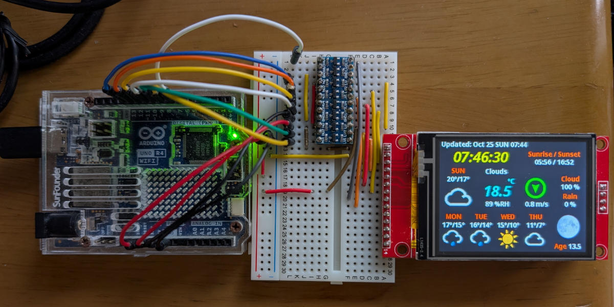
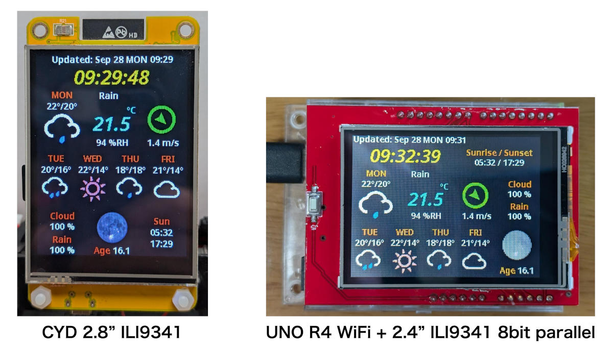

# ArduinoOpenWeather

## What is this?



This is yet another OpenWeather App for UNO R4 WiFi and ESP32.

Inspired by the cool screen design of [OpenWeahter][1] by [Bodmer, the creator of TFT_eSPI][2], I migrated it for my UNO R4 WiFi.

## Software Requirements

### Libraries
- [moononournation/Arduino_GFX][3] v1.6.9
- [ArduinoJson][4] 7.4.3

### UNO R4 WiFi

| Package                    | Version                                     |
| -------------------------- | ------------------------------------------- |
| Platform / Board           | [Arduino UNO R4 Boards by Arduino][5] 1.6.0 |
| NTP Client                 | [NTPClient][6] 3.2.1                        |
| HTTP Client (experimental) | [ArduinoHttpClient][7] 0.6.1                |

### ESP32

| Package        | Version                                |
| -------------- | -------------------------------------- |
| Board Platform | [esp32 by Espressif Systems][8] 3.3.12 |

## Software Configuration

1. Open [`config.h`][9] and configure the following:

    | Item                  | Configuration Parameters                                             |
    | --------------------- | -------------------------------------------------------------------- |
    | **OpenWeather API**   | `LANGUAGE`, `LATITUDE` and `LONGITUDE`                               |
    | **Timezone**          | `NTP_TIMEZONE_OFFSET` (UNO R4 WiFi) or `NTP_TIMEZONE_STRING` (ESP32) |

2. Create your `secrets.h` for WiFi credential and OpenWeather API key:

    ```c++
    #define SECRET_SSID "***** Your SSID *****"
    #define SECRET_PASS "***** Your password *****"
    #define API_KEY     "***** your OpenWeather key *****"
    ```

3. Open [`rtcntp.cpp`][10] and configure nearby NTP servers:

    ```c++
    static const char *ntpServers[] = {
      "ntp.nict.jp",
      "ntp.jst.mfeed.ad.jp",
      "pool.ntp.org",
      "time.google.com",
      //"europe.pool.ntp.org",
      //"time.cloudflare.com",
      //"time.aws.com",
    };
    ```

4. Open [`gfx.cpp`][11] and check and modify the LCD driver IC number to suit your device:

    ```c++
    //-------------------------------------------------------------------------------------
    // Configuration
    // 93410 and 77890 are for MCUFRIEND-type LCDs.
    //-------------------------------------------------------------------------------------
    #define USE_TFT_DRIVER  9341  // Select Driver : 9341[0], 7789[0], 9486, 7796
    #define USE_OPERATION   2     // Init operation: type 1 (default) or type 2 (variant)
    ```

  

5. Open [`gfx_config.hpp`][12] and check and modify the GPIO pin assignment to suit your device:

    ```c++
    //-------------------------------------------------------------------------------------
    // SPI GPIO pin assignment
    //-------------------------------------------------------------------------------------
    #if defined(ARDUINO_ARCH_RENESAS_UNO) || defined(ARDUINO_ARCH_AVR)
      // Arduino UNO R4 WiFi
      // https://github.com/arduino/ArduinoCore-renesas/blob/main/variants/UNOWIFIR4/pins_arduino.h
      // TFT_RST and TFT_DC should be configured based on your wiring
      #define TFT_RST       8         // D8
      #define TFT_DC        9         // D9
      #define TFT_CS        10        // CS
      #define TFT_MOSI      MOSI      // 11
      #define TFT_MISO      MISO      // 12
      #define TFT_SCLK      SCK       // 13
      #define TFT_BL        -1        // Connect directly to 3.3V
      #define SPI_FREQUENCY 24000000  // RA4M1: 24MHz, SPI: 12MHz

    #else  // ESP32
      // ESP32-2432S028R (CYD)
      // https://github.com/espressif/arduino-esp32/blob/master/variants/jczn_2432s028r/pins_arduino.h
      #define TFT_RST       -1
      #define TFT_DC        2
      #define TFT_MISO      12
      #define TFT_MOSI      13
      #define TFT_SCLK      14
      #define TFT_CS        15
      #define TFT_BL        21
      #define SPI_FREQUENCY 80000000  // ILI9341 for ESP32 (40MHz or 80MHz)
    #endif
    ```

## ToDo List

- [x] Fix the day of the week from 21:00 through midnight.
- [x] Display progress on the opening splash screen.
- [x] Make weather icons multi-colorizing.
- [x] Make lunar phase images reverse for the Northern and Southern Hemispheres.
- [x] Verify Daylight Saving Time by `timezone` returned from OpenWeather.
- [x] Supress debug printing to the Serial Monitor.

## Acknowledgement

### Icon Fonts

I would like to express my gratitude to the creators of these cool icon fonts:

- [kickstandapps/WeatherIcons][13] licensed under the [SIL OPEN FONT LICENSE Version 1.1][15].
- [erikflowers/weather-icons][14] licensed under the [SIL OPEN FONT LICENSE Version 1.1][15].


[1]: https://github.com/Bodmer/OpenWeather "Bodmer/OpenWeather: Arduino library to fetch weather information from OpenWeather"

[2]: https://github.com/Bodmer/TFT_espi "Bodmer/TFT_eSPI: Arduino and PlatformIO IDE compatible TFT library optimised for the Raspberry Pi Pico (RP2040), STM32, ESP8266 and ESP32 that supports different driver chips"

[3]: https://github.com/moononournation/Arduino_GFX "moononournation/Arduino_GFX: Arduino GFX developing for various color displays and various data bus interfaces"

[4]: https://github.com/bblanchon/ArduinoJson "bblanchon/ArduinoJson: 📟 JSON library for Arduino and embedded C++. Simple and efficient."

[5]: https://github.com/arduino/ArduinoCore-renesas "arduino/ArduinoCore-renesas"

[6]: https://github.com/arduino-libraries/NTPClient "arduino-libraries/NTPClient: Connect to a NTP server"

[7]: https://github.com/arduino-libraries/ArduinoHttpClient "arduino-libraries/ArduinoHttpClient: Arduino HTTP Client library"

[8]: https://github.com/espressif/arduino-esp32 "espressif/arduino-esp32: Arduino core for the ESP32"

[9]: config.h
[10]: rtcntp.cpp#L14-L22
[11]: gfx.cpp#L18-L23
[12]: gfx_config.hpp#L21-L48

[13]: https://github.com/kickstandapps/WeatherIcons "kickstandapps/WeatherIcons: Open-sourced weather icons and font for UI design."

[14]: https://github.com/erikflowers/weather-icons "erikflowers/weather-icons: 215 Weather Themed Icons and CSS"

[15]: https://openfontlicense.org/open-font-license-official-text/ "SIL Open Font License Official Text"